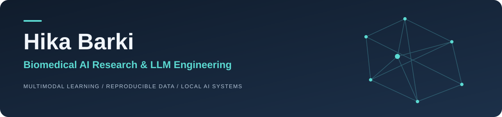
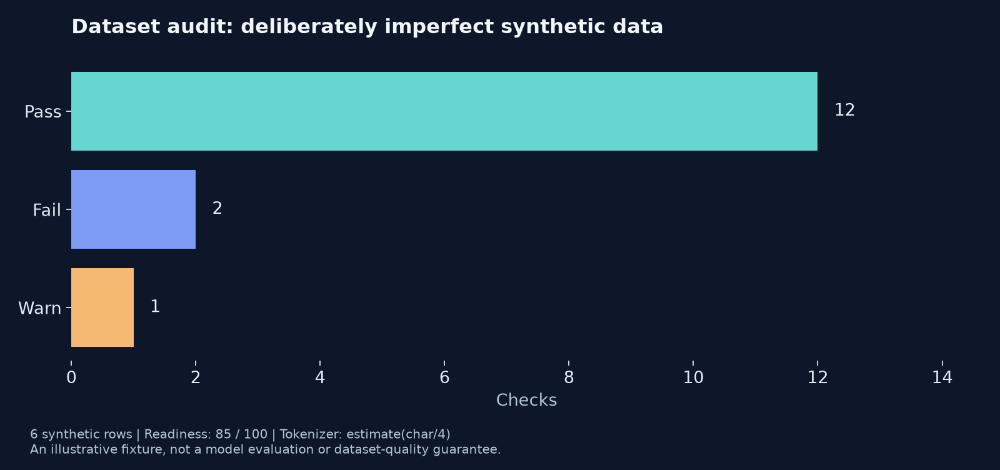
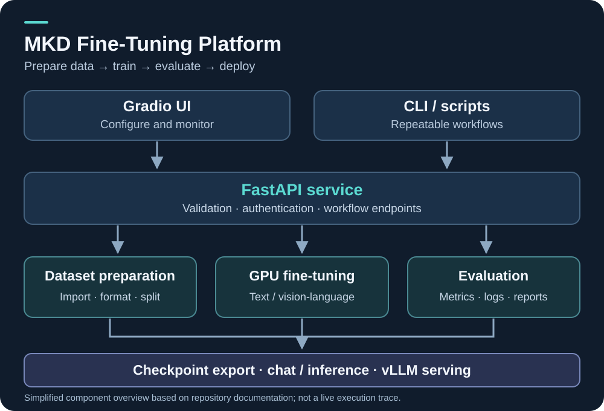
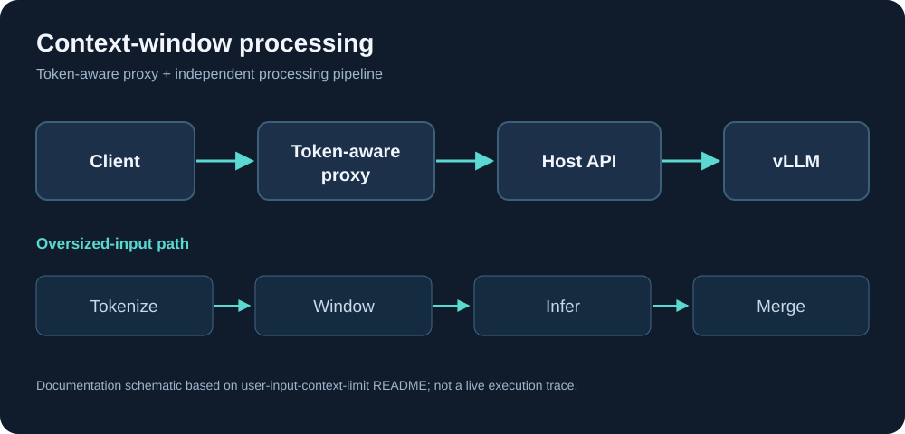
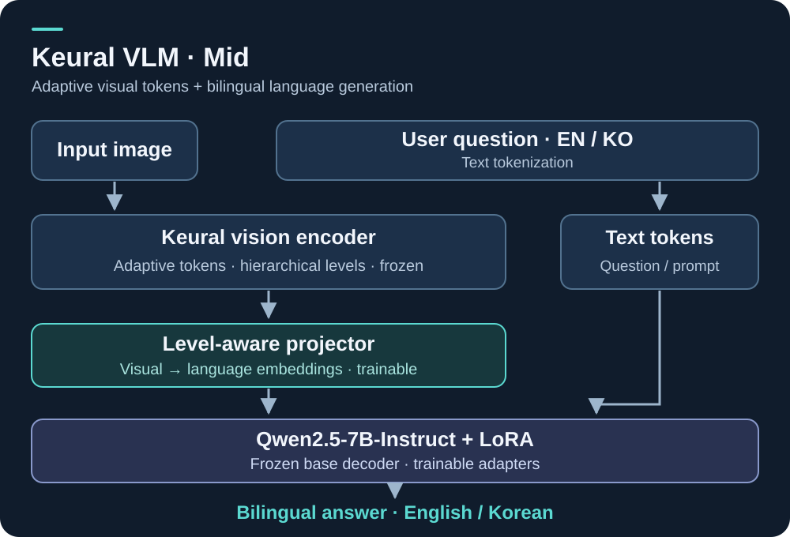
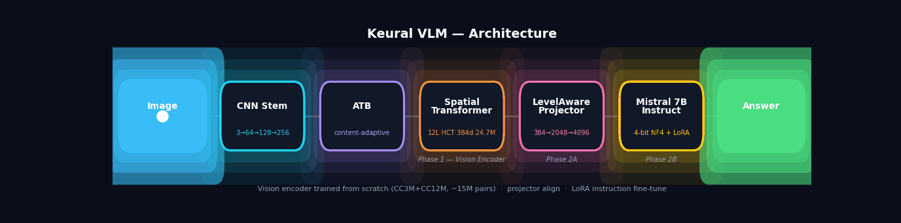

**Biomedical AI · Multimodal Learning · LLM Engineer · Reproducible Systems**

[Research publications](https://scholar.google.com/citations?user=tGNh80cAAAAJ&hl=en) · [Hugging Face](https://huggingface.co/Hikaf143) · [Selected portfolio](https://huggingface.co/collections/Hikaf143/korean-llms-and-synthetic-clinical-text-safeguards-6acdc88354cc57f9dc7a9421) · [Company work](https://github.com/MKD-CORP)

My other GitHub account: **[mkd-hika](https://github.com/mkd-hika)** — earlier work, activity, and GitHub achievements.

## About

I am a biomedical AI researcher and machine learning engineer working across physiological signal analysis, wearable sensing, medical imaging, and transformer-based learning. My publication record includes first-author work in **IEEE Journal of Biomedical and Health Informatics**, **IEEE Sensors Journal**, and **IEEE BioCAS**.

At MKD, I work on Korean–English language-model workflows and the engineering systems around data preparation, fine-tuning, evaluation, and local deployment. I build tools that make those workflows easier to inspect and reproduce, connecting research ideas with practical Python APIs, command-line tools, and usable interfaces.

My interests include multimodal learning, subject-level evaluation, reliable language-model systems, and privacy-conscious AI for healthcare and enterprise applications.

## Project gallery

Click any preview to explore its repository. These are existing project artifacts and documentation diagrams; the GIF is an animated architecture illustration, not a recording of a running application.

<table>
<tr>
<td width="50%" valign="top" align="center">

<h3><a href="https://github.com/hikabarki/llm-dataset-inspector">LLM Dataset Inspector</a></h3>

Structure, quality, formatting, and leakage checks with evidence.

Example audit report · six-row synthetic fixture

</td>
<td width="50%" valign="top" align="center">

<h3><a href="https://github.com/hikabarki/MKD--Finetuning-platform">MKD Fine-Tuning Platform</a></h3>

Dataset preparation, GPU training, evaluation, and serving interfaces.

Compact vector architecture · inspect README for implementation details

</td>
</tr>
<tr>
<td width="50%" valign="top" align="center">

<h3><a href="https://github.com/hikabarki/user-input-context-limit">Context-Window Tooling</a></h3>

Token-aware request handling and oversized-input processing.

Documentation schematic · not a live trace

</td>
<td width="50%" valign="top" align="center">

<h3><a href="https://github.com/hikabarki/Keural-Vision-Encoder-Mid-level">Keural Vision Encoder · Mid</a></h3>

Content-adaptive tokenization and hierarchical visual representations.

Original technical architecture diagram

</td>
</tr>
<tr>
<td width="50%" valign="top" align="center">

<h3><a href="https://github.com/hikabarki/Keural-VLM-Mid-level">Keural VLM · Mid</a></h3>

Bilingual vision-language modeling and sighted-versus-blind evaluation.

Compact vector block diagram · frozen and trainable components labeled

</td>
<td width="50%" valign="top" align="center">

<h3><a href="https://github.com/hikabarki/VISION-ENCODER_tiny">Keural Vision Encoder · Tiny</a></h3>

Image-to-token-to-language pipeline with an adaptive visual token budget.

Animated architecture · original project GIF

</td>
</tr>
</table>

## Featured engineering projects

| Project | What to inspect |
|---|---|
| **[SFT Dataset Builder](https://github.com/hikabarki/sft-dataset-builder-1)** | Local conversion of documents, images, audio, and video into structured training datasets; Python API, CLI, and Streamlit UI. |
| **[LLM Dataset Inspector](https://github.com/hikabarki/llm-dataset-inspector)** | Dataset structure, duplicate checks, chat formats, token budgets, and train/evaluation leakage, with evidence and remediation suggestions. |
| **[MKD Fine-Tuning Platform](https://github.com/hikabarki/MKD--Finetuning-platform)** | Gradio and FastAPI interfaces for NVIDIA GPU fine-tuning of text and vision-language models; setup and deployment documentation. |
| **[SkillForge](https://github.com/hikabarki/skillforge)** | Reproducible training-data pipeline and fixture evaluation for agent-skill selection and abstention. CPU pipeline implemented; model training pending. |

## Research and selected publications

My research spans biomedical signals, multimodal sensing, medical-image analysis, and transformer-based classification. Selected first-author publications:

- **[Optimized XGBoost for Multimodal Affective State Classification Using In-Ear PPG and Behind-the-Ear EEG Signals](https://doi.org/10.1109/JBHI.2025.3598354)** — IEEE Journal of Biomedical and Health Informatics; early access 2025, final issue 2026.
- **[Detection and Classification of Mental Stress Using In-Ear Plethysmography and a Vision Transformer](https://doi.org/10.1109/JSEN.2024.3512595)** — IEEE Sensors Journal; early access 2024, volume 25(2).
- **[Stress-ViT: In-Ear Plethysmography for Mental Stress Classification with Vision Transformer](https://doi.org/10.1109/BioCAS58349.2023.10389058)** — IEEE BioCAS 2023.

[Full publication profile](https://scholar.google.com/citations?user=tGNh80cAAAAJ&hl=en) · [Supplied bibliography and publication details](https://huggingface.co/spaces/Hikaf143/synthetic-emr-safeguards/blob/main/PUBLICATIONS.md)

## Reproduce and explore

- **[Dataset Builder examples](https://github.com/hikabarki/sft-dataset-builder-1/tree/main/examples):** inspect bundled inputs and reproduce the dataset-building workflow.
- **[Dataset Inspector examples](https://github.com/hikabarki/llm-dataset-inspector/tree/main/examples):** inspect audit evidence and generated reports.
- **[SkillForge examples](https://github.com/hikabarki/skillforge/tree/main/examples):** reproduce the CPU fixture pipeline and baseline reports.
- **[Synthetic EMR demo](https://huggingface.co/spaces/Hikaf143/synthetic-emr-safeguards):** inspect patient-level splits, identifier redaction, exact evidence citations, and refusal when information is absent.

The EMR demo uses fully synthetic records and a deterministic extraction baseline. It is an engineering safeguards prototype prepared with AI coding assistance, not a clinically validated system or an evaluation of a clinical LLM. Published biomedical studies and company models are separate work with their own evidence and attribution.

## Tools and methods

**Python · PyTorch · Transformers · FastAPI · Gradio · Streamlit · Docker · Git**

Biomedical signal processing · Vision transformers · Multimodal learning · Training-data quality · Fine-tuning pipelines · Local model serving · Reproducible evaluation

---

Explore each repository's README for implementation status, setup instructions, authorship, licensing, and known limitations. Original team and upstream credits are retained in company projects and fork-derived repositories.
