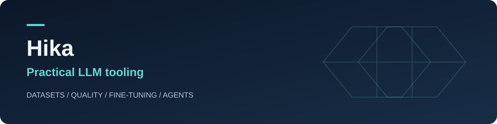

**Dataset preparation · Data quality · Fine-tuning · Agent tooling**

[Explore my projects](https://github.com/mkd-hika?tab=repositories) · [Hugging Face](https://huggingface.co/mkd-hika) · [Dataset Inspector demo](https://huggingface.co/spaces/mkd-hika/llm-dataset-inspector)

## About

I build tools that make LLM workflows easier to inspect, reproduce, and use — from turning raw files into training datasets to auditing data quality and managing fine-tuning.

My public projects focus on Python tooling, local processing, and interfaces that connect data preparation with model development.

## Featured projects

| Project | What it does |
| :--- | :--- |
| **[SFT Dataset Builder](https://github.com/mkd-hika/sft-dataset-builder)** | Converts documents, images, audio, and video into structured training datasets, with a Python API, CLI, and Streamlit UI. |
| **[LLM Dataset Inspector](https://github.com/mkd-hika/llm-dataset-inspector)** | Audits dataset structure, duplicates, chat formats, token budgets, and train/eval leakage, with evidence and remediation suggestions. |
| **[MKD Fine-Tuning Platform](https://github.com/mkd-hika/MKD--Finetuning-platform)** | Provides a Gradio UI and FastAPI API for NVIDIA GPU fine-tuning of text and vision-language models. |
| **[SkillForge](https://github.com/mkd-hika/skillforge)** | Builds training data from agent skills and evaluates skill selection and abstention. The CPU data pipeline is implemented; model training is pending. |

## Try the projects

- **[Dataset Builder example](https://github.com/mkd-hika/sft-dataset-builder/tree/main/examples):** turn the bundled text into three training samples with one command.
- **[Dataset Inspector report](https://github.com/mkd-hika/llm-dataset-inspector/tree/main/examples):** reproduce an audit and inspect its JSON, HTML, and Markdown outputs.
- **[SkillForge fixture baselines](https://github.com/mkd-hika/skillforge/tree/main/examples):** reproduce the CPU pipeline and view its baseline reports. No model training is claimed.

## Tools I work with

## Areas of interest

- Local LLM workflows and model serving
- Training data quality and reproducible pipelines
- Fine-tuning and model evaluation
- Agent skills and developer tooling

---

Explore a repository's README for setup instructions, current status, and known limitations.
